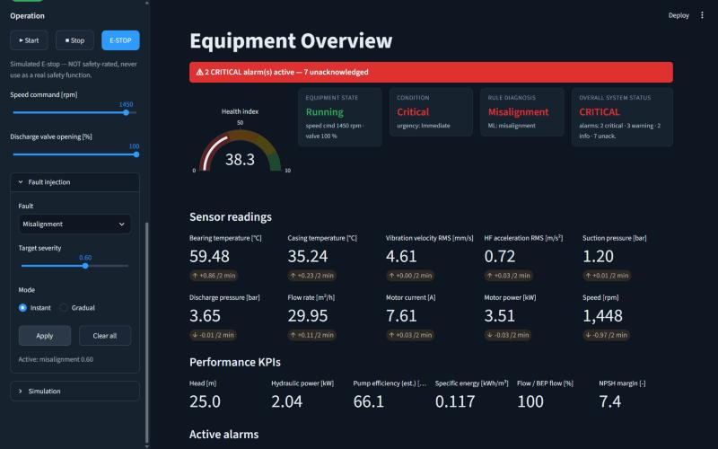
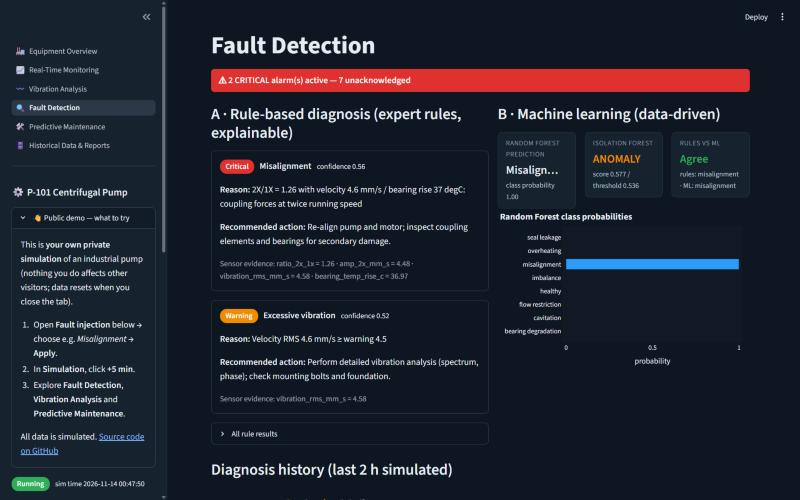
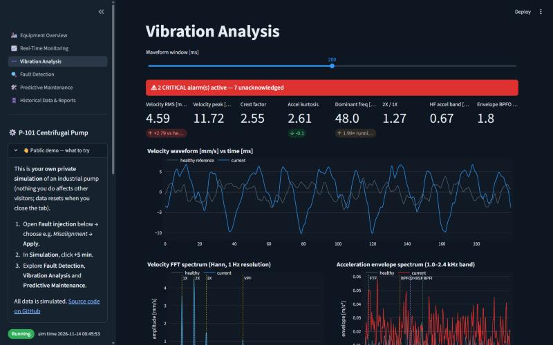
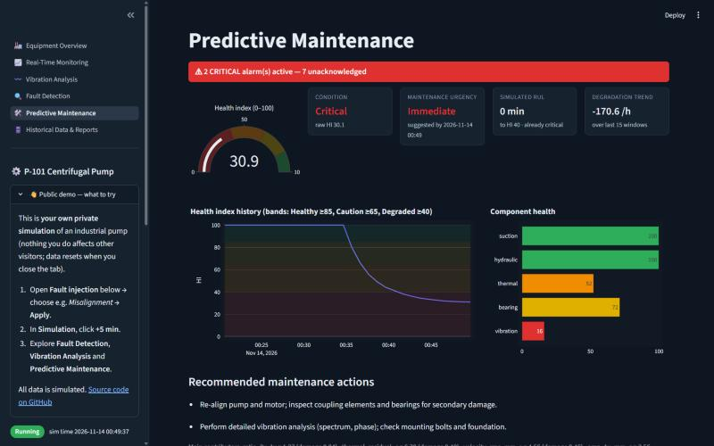
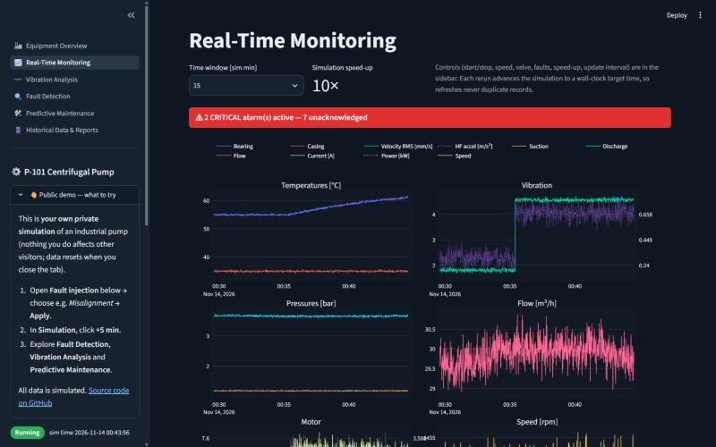
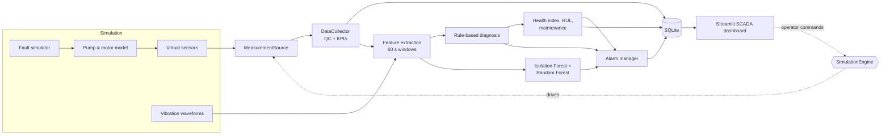

# Centrifugal Pump Monitoring & AI-Based Predictive Maintenance

A complete, software-only condition-monitoring system for an industrial centrifugal pump, written in Python.
It simulates the pump and its sensors, injects seven realistic mechanical and hydraulic faults, performs
engineering and vibration analysis, diagnoses faults with expert rules **and** machine learning, computes an
explainable health index with a simulated remaining-useful-life (RUL) estimate, manages alarms, stores
everything in SQLite and presents it in a six-page SCADA-style dashboard.

### Screenshots (misalignment fault injected)

| Equipment overview | Fault detection: rules vs ML |
|---|---|
|  |  |
| **Vibration analysis (2X peak = misalignment)** | **Predictive maintenance** |
|  |  |

<details><summary>Real-time monitoring</summary>


</details>

> **All equipment and data are simulated.** No hardware is needed. Thresholds, health bands and RUL are
> demonstration values, not certified industrial limits, and results on synthetic data do **not** establish
> industrial diagnostic accuracy. The simulated emergency stop is **not** a safety function.

---

## Main features

| Area | What it does |
|---|---|
| **Pump & motor model** | Parabolic H–Q and η–Q curves through the rated point (7.5 kW motor, 1450 rpm, 30 m³/h, 25 m, 70 %), system curve with valve, operating-point solution, exact affinity laws, NPSH & cavitation, VFD start/stop ramps, latched E-stop, thermal lags, motor current with part-load power factor |
| **Virtual sensors** | 10 timestamped sensors (bearing & casing temperature, vibration velocity & HF acceleration, suction & discharge pressure, flow, current, power, speed) with realistic noise, flow-meter cut-off, dropouts and instrument failures (dead, stuck, drift, offset, spike) |
| **7 fault scenarios** | Bearing degradation, imbalance, misalignment, cavitation, flow restriction, seal leakage, overheating — each with documented physics, severity 0–1, step/linear/exponential growth, simultaneous faults, repair |
| **Engineering calculations** | ΔP, H = ΔP/ρg, P<sub>h</sub> = ρgQH, pump & wire-to-water efficiency, specific energy, affinity laws, NPSH margin, pump-curve flow deficit, head deviation, **system-resistance ratio** (separates deliberate throttling from blockage) |
| **Vibration analysis** | 5 kHz waveforms with 1X/2X/3X/vane-pass, bearing impacts at BPFO, cavitation noise; RMS, peak, crest factor, kurtosis, FFT, harmonics, BPFO/BPFI/BSF/FTF, envelope (demodulation) spectrum |
| **Data acquisition & DB** | Hardware-abstraction (`MeasurementSource`), QC (duplicates, missing, range, rate-of-change, gap fill), SQLite with 6 tables, duplicate-safe inserts, date filters, CSV export |
| **Diagnosis** | Rule-based expert system (combined evidence, Normal/Warning/Critical, evidence, reason, recommended action) + Isolation Forest anomaly detection + Random Forest fault classification (leakage-free split by simulation run) |
| **Predictive maintenance** | Explainable health index 0–100 (5 components), degradation trend, simulated RUL, urgency, recommendations, schedule, automatic work orders |
| **Alarms** | Info / Warning / Critical, deadbands, acknowledge, latched clear, reset, duplicate suppression, escalation, history |
| **Dashboard** | Streamlit + Plotly, 6 pages, live updates, operator controls, fault injection, CSV & HTML report downloads |

## Results (simulated data)

| Check | Result |
|---|---|
| Automated tests | **221 passed** (`pytest tests/`) |
| Rule-based diagnosis, fresh validation runs, severity ≥ 0.3 | **0 % false positives**, 96.5 % detection, **98.0 %** correct fault |
| Random Forest, fresh validation runs, severity ≥ 0.3 | **96.8 %** accuracy, macro-F1 0.958, 0.6 % false positives |
| Isolation Forest (unsupervised) | ROC-AUC 0.88, 1.1 % false alarms |
| End-to-end scenarios (full pipeline, 60 min each) | All 8 fault scenarios identified by rules and ML; **0 false positives** in 3 healthy runs at different operating points; see [`reports/validation_report.md`](reports/validation_report.md) |
| Performance | Engine 870× real time; live tick ≈ 7 ms; page reruns 45–250 ms |

## System architecture



A real installation would replace `SimulatedSource` with a Modbus / OPC UA client implementing the same
`read()` method; everything downstream stays unchanged (see [`docs/industrial_integration.md`](docs/industrial_integration.md)).

```text
pump_predictive_maintenance/
├── app.py                       Streamlit entry point (6 pages)
├── build_artifacts.py           regenerate datasets, models, reports
├── config/pump_config.py        ALL parameters (pump, motor, sensors, rule limits, health bands)
├── simulation/                  pump_model, sensor_simulator, fault_simulator, vibration_signal
├── acquisition/data_collector.py
├── analysis/                    hydraulic_calculations, vibration_analysis, feature_extraction,
│                                performance/vibration reports, scenario_validation
├── detection/                   rule_based, ml_detection
├── predictive_maintenance/health_monitor.py
├── alarms/alarm_manager.py
├── database/database_manager.py
├── dashboard/                   engine, ui, overview, realtime, vibration, fault_analysis,
│                                maintenance, historical_data
├── tests/                       221 pytest tests
├── docs/                        engineering assumptions, industrial integration, CV/LinkedIn text
├── data/  models/  reports/     generated (git-ignored except reports)
├── PROJECT_STATUS.md            development record
└── requirements.txt
```

## Installation

Requires **Python 3.11+** (developed on 3.12, Windows 11).

```bash
python -m venv .venv
.venv\Scripts\activate            # Windows   (Linux/macOS: source .venv/bin/activate)
python -m pip install -r requirements.txt
python build_artifacts.py         # datasets + ML models + reports, ~2-4 min
```

`pyarrow` and `scikit-learn` are pinned (21.0.0 / 1.7.2) because this pinned versions work everywhere (Others may show some complexities).

## Run the dashboard

```bash
streamlit run app.py
```

Open http://localhost:8501. The pump starts running at its rated point; the simulation runs 10× faster
than real time by default.

### Operating the dashboard

* **Sidebar → Operation:** Start, Stop, E-STOP (latched; *Reset emergency stop* once the shaft has stopped),
  speed command and discharge-valve opening.
* **Sidebar → Fault injection:** choose a fault, target severity and *Instant* or *Gradual* (ramp duration);
  *Clear all* returns to healthy. Several faults can be active at once.
* **Sidebar → Simulation:** speed-up (1–300×), live update on/off and interval, pause, fast-forward +5 / +30 min.
* **Pages:** Equipment Overview (status, sensors, KPIs, alarm table with acknowledge / reset) · Real-Time
  Monitoring · Vibration Analysis · Fault Detection (rules vs ML) · Predictive Maintenance (health, RUL,
  work orders) · Historical Data & Reports (date filter, trends, H–Q performance, CSV and HTML report download).

### Simulating a fault — example

1. Fault injection → *Misalignment*, severity 0.6, *Instant* → **Apply**.
2. Within a few simulated minutes: the overview shows rule & ML diagnosis *Misalignment*, the health index
   drops, alarms appear (Critical diagnosis, vibration high, health degraded).
3. Vibration page: dominant peak at **2X** running speed, 2X/1X > 1 — the classic misalignment signature.
4. Predictive Maintenance: urgency, recommended action (laser alignment, coupling inspection) and an
   automatic work order; complete it with *Fault repaired* ticked to return to healthy.

## Interpreting the results

* **Health index:** ≥ 85 Healthy · 65–84 Caution · 40–64 Degraded · < 40 Critical. Each component
  (vibration, bearing, thermal, hydraulic, suction) is scored separately; the worst component dominates.
* **Rule diagnosis** is explainable: every result lists the sensor evidence, the reason and an action.
* **ML** shows the Random Forest class probabilities and the Isolation Forest anomaly score versus its
  threshold; the Fault Detection page states whether rules and ML agree.
* **RUL** is a trend extrapolation to HI = 40 on simulated degradation — treat it as indicative only.
* Typical fault signatures: imbalance → 1X; misalignment → 2X; bearing → envelope peaks at BPFO and high
  kurtosis; cavitation → low NPSH margin + HF noise; restriction → system resistance ↑; seal leakage → flow
  below the pump curve; overheating → bearing hotter than expected for the load.

## Development & testing

```bash
python -m pytest tests/ -v                     # 221 tests
python -m analysis.scenario_validation         # end-to-end validation report
python -m detection.ml_detection               # retrain models, metrics in reports/
```

Engineering assumptions: [`docs/engineering_assumptions.md`](docs/engineering_assumptions.md) ·
development log, decisions and issues: [`PROJECT_STATUS.md`](PROJECT_STATUS.md).

## Limitations

* Simulated physics with engineering-estimate fault magnitudes; constant motor efficiency; water only.
* Single pump; single vibration measurement point (no axial/phase analysis); outer-race bearing defect only.
* Rule thresholds and ML were developed on the same simulator family — industrial use requires machine-specific
  baselines, field data and validation.
* RUL is a simulated trend estimate, not a validated prognosis.

## Roadmap (deferred, Priority 3)

Multi-pump monitoring and comparison · energy/efficiency optimisation · advanced maintenance scheduling ·
simulated Modbus TCP server (`pymodbus`) · simulated OPC UA server (`asyncua`) · digital-twin visualisation ·
e-mail notifications · advanced ML (gradient boosting, sequence models, uncertainty-aware RUL) · valve-position-aware
ML features for wider operating ranges.
